

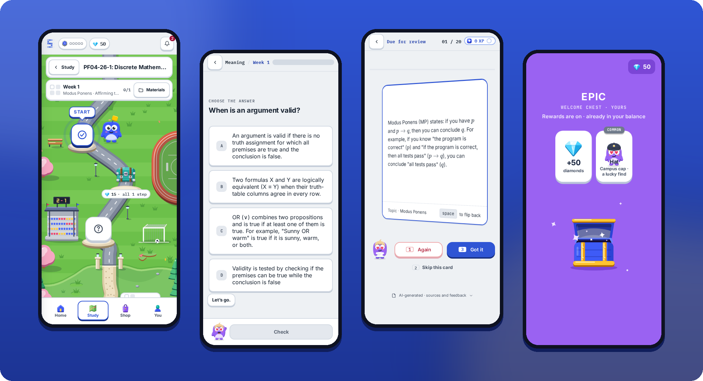

# StudySync

**Your course in Moodle or Canvas, turned into practice. Week by week.**

[studysync.nl](https://studysync.nl) · [@studysyncnl](https://www.instagram.com/studysyncnl)

## What this repository is

An explainer. It holds this page and the pictures on it, and no source code: the app's code is in a
private repository. Every picture is a screenshot of the real app on a demo account.

StudySync is pre-launch. It has no customers yet and runs as a private beta behind invite codes.

## What it does

A student connects their school's learning platform once. StudySync reads the course, keeps what is
study material, and makes practice from it for every week of the course:

| | |
| --- | --- |
| **Flashcards** | From every part of the week's material, with spaced repetition: a card you miss comes back tomorrow, a card you know comes back after 1, 3, 7, 14 and then 30 days |
| **A quiz per week** | Ten multiple-choice questions over the week's material |
| **A cheatsheet per course** | The course on one page |
| **A path per course** | Each week is a short row of steps, so there is always one obvious next thing to do |

The practice is made by AI and labelled as AI-made on every card and question. The course material
stays the reference.

## How it works

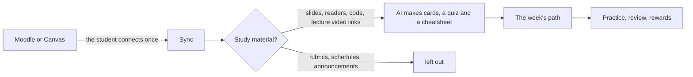

1. **Connect.** Moodle with a personal web-service token; Canvas through the school's own sign-in.
2. **Sync.** Courses, weeks, files and deadlines come in. Rubrics, schedules, attendance lists and
   other course admin are left out, and a section with nothing to learn gets no deck.
3. **Generate.** All of the material is used, in chunks when it is long. Nothing is sampled away.
4. **Practise.** The week's steps, then a week check. Cards you practised come back when they are due.

## The week's path

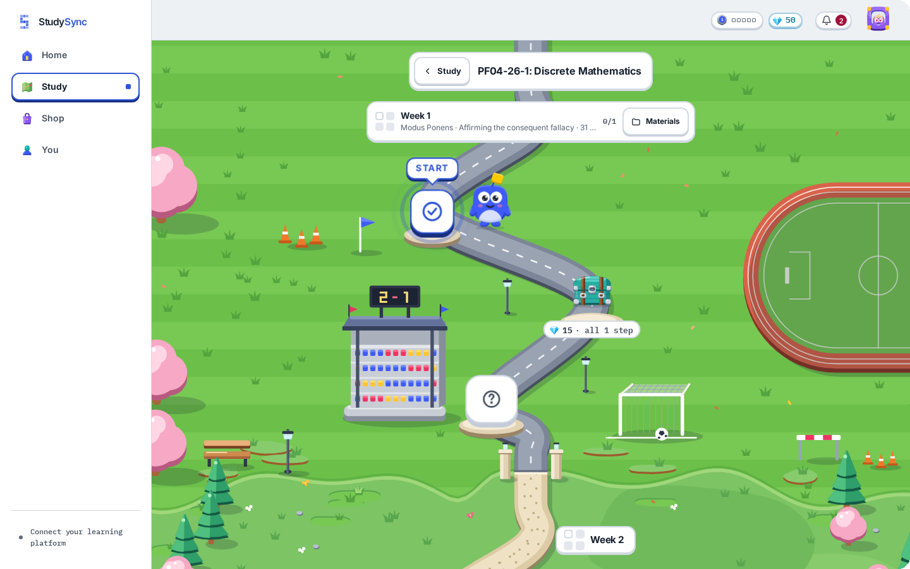

Each week of a course is a place on a campus, and its steps stand along a road. The next step is
always the one that is lit.

<table>
  <tr>
    <td width="25%">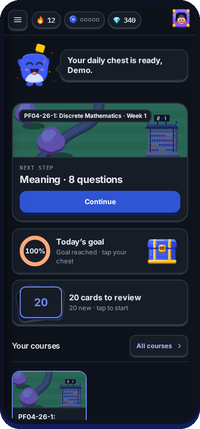</td>
    <td width="25%">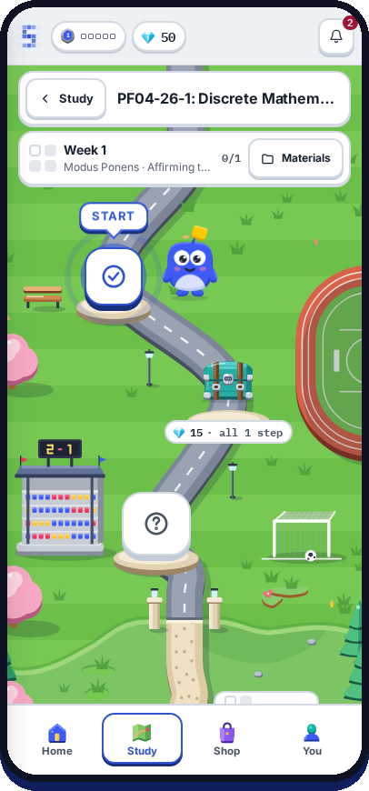</td>
    <td width="25%">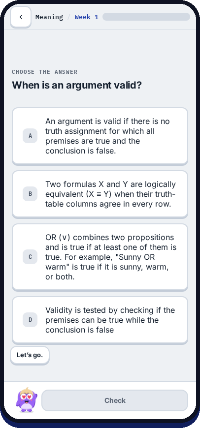</td>
    <td width="25%">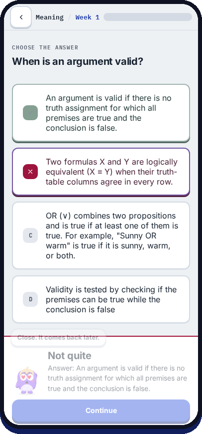</td>
  </tr>
  <tr>
    <td align="center"><b>Home</b> One next step</td>
    <td align="center"><b>Path</b> The week as steps</td>
    <td align="center"><b>A step</b> Pick the meaning</td>
    <td align="center"><b>A miss</b> "Not quite", never a red buzzer</td>
  </tr>
</table>

## Cards and quizzes

<table>
  <tr>
    <td width="25%">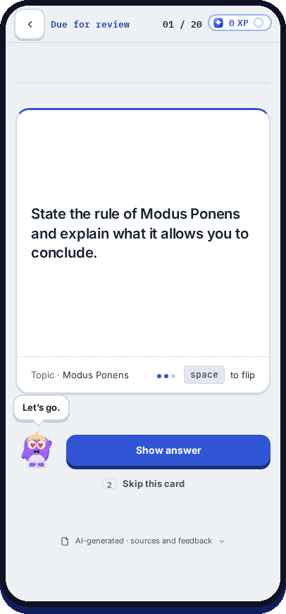</td>
    <td width="25%">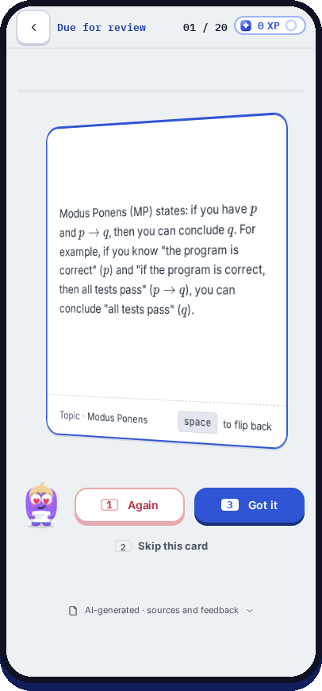</td>
    <td width="25%">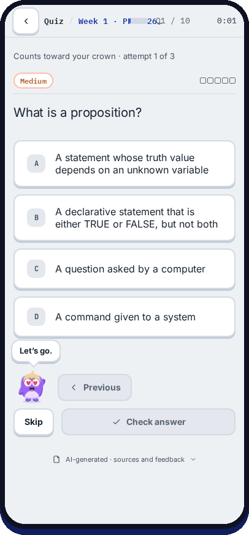</td>
    <td width="25%">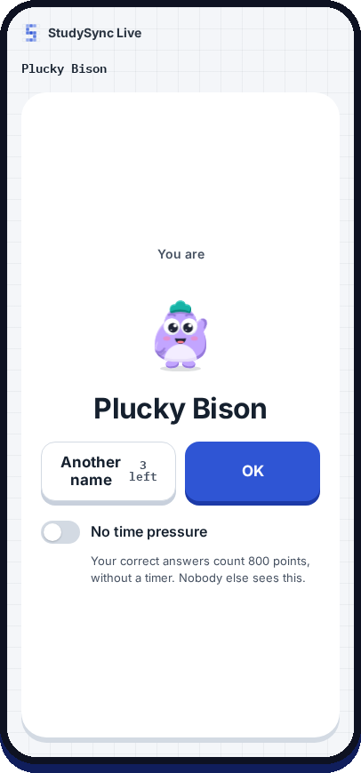</td>
  </tr>
  <tr>
    <td align="center"><b>Card, front</b></td>
    <td align="center"><b>Card, back</b> Again or Got it</td>
    <td align="center"><b>Week quiz</b> No answer key is sent before you answer</td>
    <td align="center"><b>Live</b> A class quiz, under a made-up name</td>
  </tr>
</table>

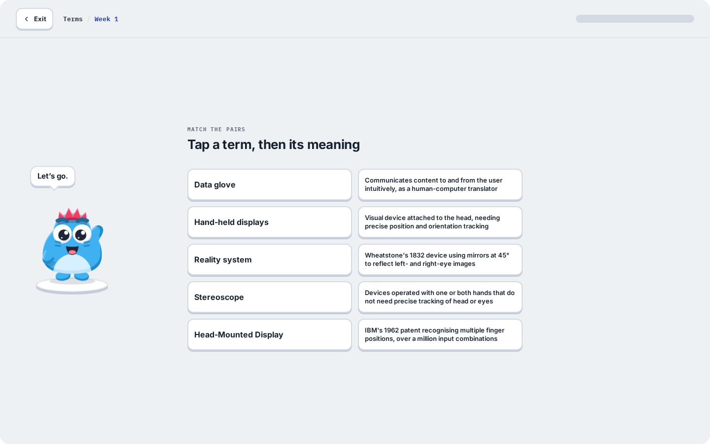

**Live** is a quiz for the whole class, on Canvas courses a teacher teaches: the teacher starts a
game on the big screen and phones join with a code. By default every player gets a made-up name and
a made-up character, so the board says nothing about who is who.

## Rewards, without a shop that takes money

<table>
  <tr>
    <td width="25%">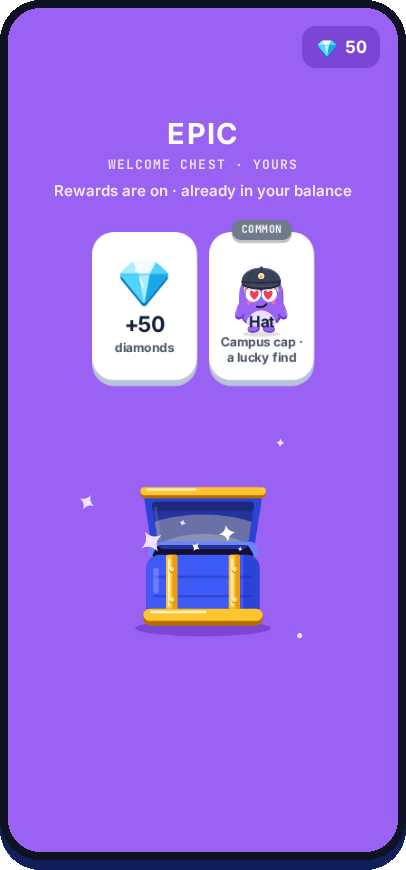</td>
    <td width="25%">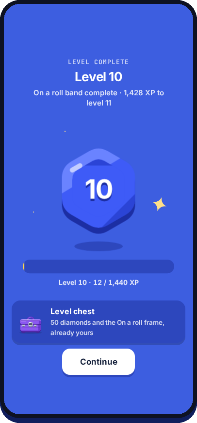</td>
    <td width="25%">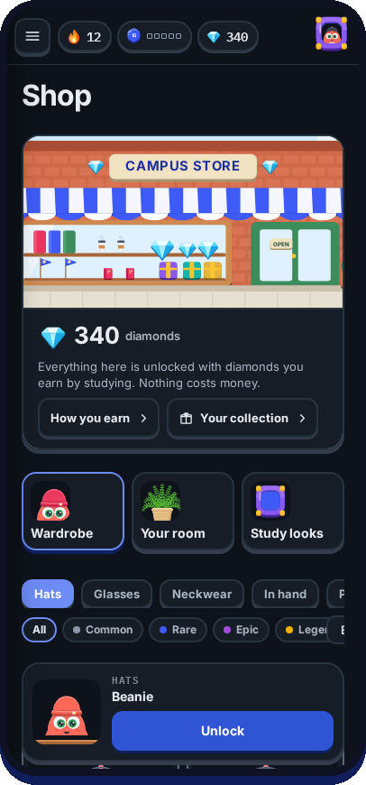</td>
    <td width="25%" valign="top">
       
      <b>Earned by studying, never bought.</b>  
      Studying pays XP and diamonds. Diamonds unlock things for your character and its room.
      Nothing in StudySync can be bought with money, and the odds of what a chest can hold are
      shown in the shop.  
      A school decides whether rewards are on at all.
    </td>
  </tr>
</table>

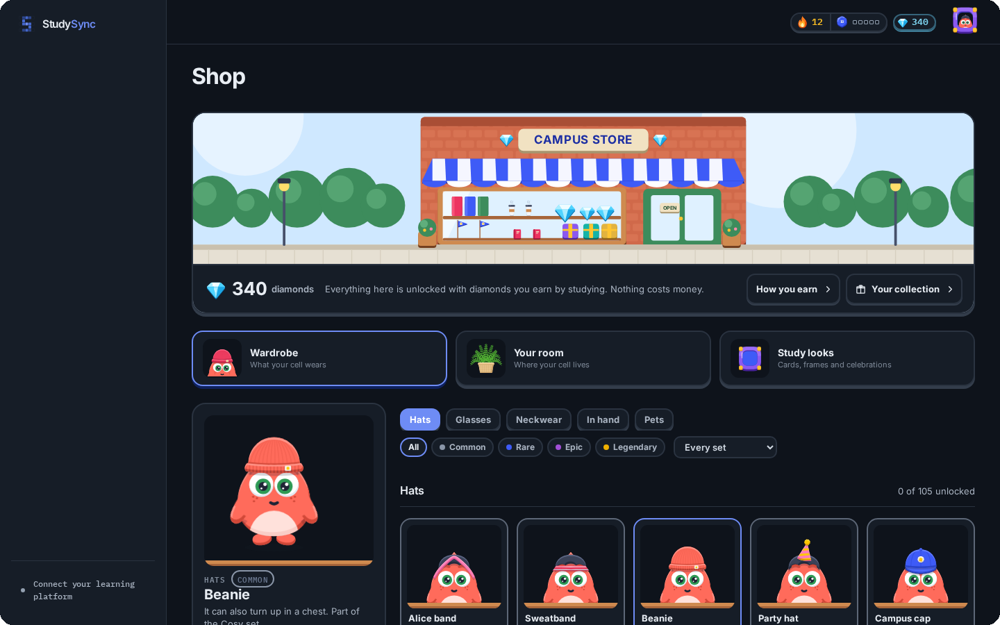

<table>
  <tr>
    <td width="50%">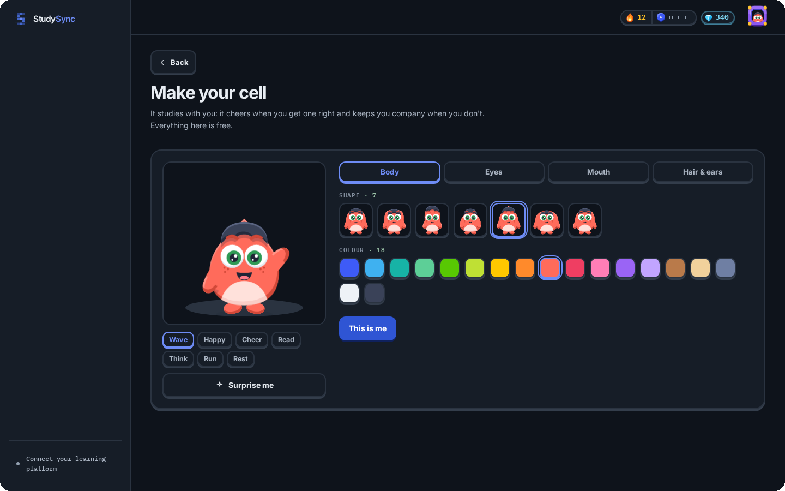</td>
    <td width="50%">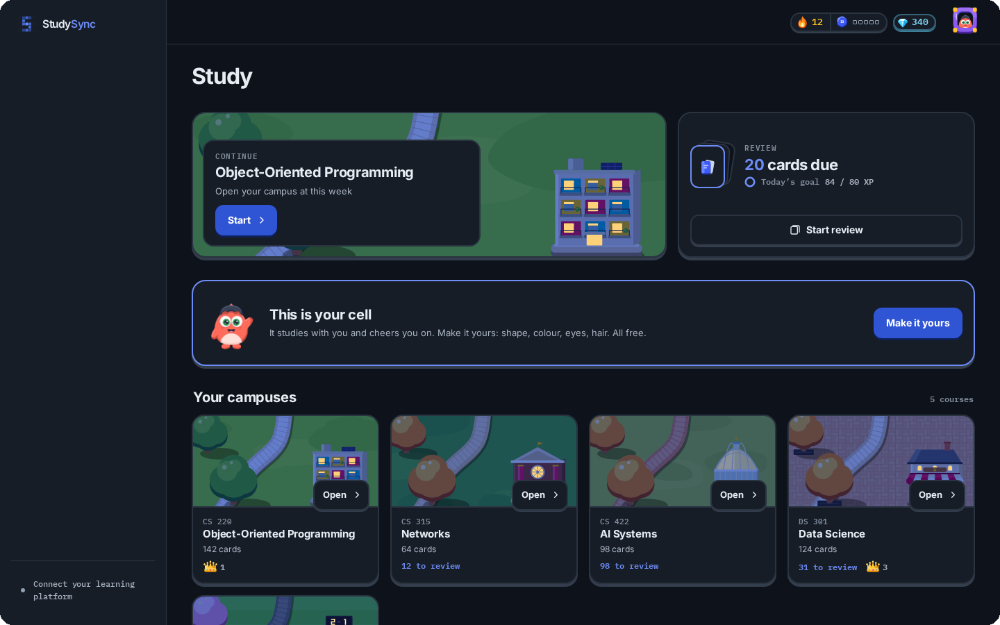</td>
  </tr>
  <tr>
    <td align="center"><b>Your cell</b> Every student has a character that studies along</td>
    <td align="center"><b>Study</b> Every course is its own campus</td>
  </tr>
</table>

## For schools

- **Students' own access.** Each student's material comes in through that student's own access to
  the learning platform.
- **Staff see little.** Staff accounts a school sets up see a roster with last activity and
  programme totals. Nobody on staff sees a student's answers, scores or rewards.
- **Tokens stay on the server.** Learning-platform tokens are encrypted (AES-256-GCM) and never
  reach the browser; files are downloaded through the server.
- **AI is labelled.** Every card and question says it is AI-generated, with its sources and a way
  to give feedback.
- **Calm mode.** One switch, or the device's reduced-motion setting, and nothing moves on its own.
- **Data location.** The database is in the EU.

Brightspace, Blackboard and other platforms are not supported yet.

## Built with

| Part | What |
| --- | --- |
| Frontend | Next.js 16, TypeScript (strict), CSS variables, Zustand, Framer Motion |
| Backend | Node.js, Express, PostgreSQL, a Postgres-backed job queue |
| AI | Anthropic Claude for cards, quizzes, cheatsheets and summaries; Google Gemini as a fallback, unless a school's deployment is pinned to Anthropic |
| Checks | Type checks and tests on every push; tests that fail when a rule is broken, such as an untrue claim on the website or an answer key sent too early |

The drawings (the campus, the characters, the chests, the icons) are the app's own SVG, drawn in
code. There are no stock illustrations.

## How it is built

By one person directing AI coding agents, mostly [Claude Code](https://claude.com/claude-code). The
direction, the rules the agents work under, and the checking are mine. The skills that came out of
that work are public: see [my profile](https://github.com/DevCrazyCube).

## Not in this repository

- The source code.
- Numbers about users. There are none to show before launch.
- A price. Pricing is discussed with schools.

## Contact

[studysync.nl](https://studysync.nl) · [@studysyncnl on Instagram](https://www.instagram.com/studysyncnl) · [Joyren Terken on LinkedIn](https://www.linkedin.com/in/joyren-terken-0bb02429a)

© 2026 Joyren Terken. The pictures and text here are not open source; ask before reusing them.
