

# StudySync

**Your course in Moodle or Canvas, turned into practice. Week by week.**

[studysync.nl](https://studysync.nl) · [@studysyncnl](https://www.instagram.com/studysyncnl)

<picture>
  <source media="(prefers-color-scheme: dark)" srcset="docs/hero-dark.png">
  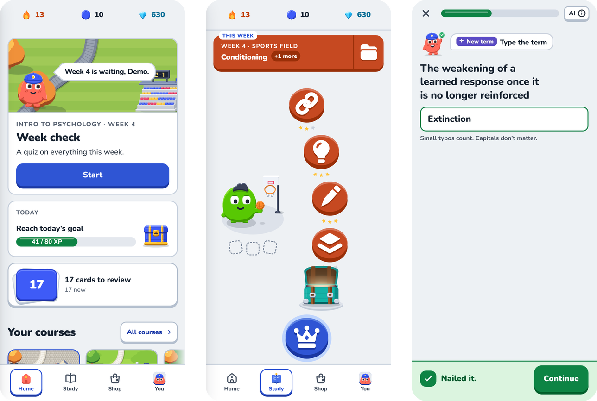
</picture>

## What this repository is

An explainer. It holds this page and the pictures and recordings on it, and no source code: the app's
code is in a private repository. Every picture here is the app's own code running on made-up example
data: an example psychology course, an example student, invented player names. There are no real
students, courses or schools in them.

StudySync is pre-launch. It has no customers and no pilots yet, and runs as a private beta behind
invite codes.

## What it does

A student connects their school's learning platform once. StudySync reads the course, keeps what is
study material, and makes practice from it for every week of the course:

| | |
| --- | --- |
| **Flashcards** | From every part of the week's material, with spaced repetition: a card you miss comes back tomorrow, a card you know comes back after 1, 3, 7, 14 and then 30 days |
| **A path per course** | Each week is a short row of steps (match the terms, pick the meaning, type it from memory, all of it mixed), then the week's chest and a Week check |
| **A quiz per week** | The Week check: multiple-choice questions over the week's material, with crowns to earn |
| **A course summary** | The course as a guidebook: one topic per week, the terms, the formulas and what to watch out for |

The practice is made by AI and marked as AI-made: every session's bar has an **AI ⓘ** chip that says
where the item comes from, with the lecture's material and a way to report it. The course material
stays the reference.

## How it works

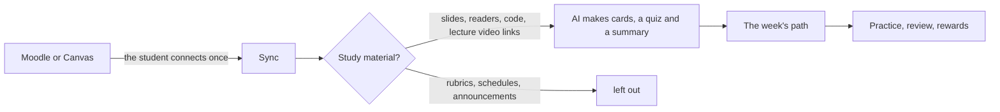

1. **Connect.** Moodle with a personal key (in the Android app: one tap on the school's own Moodle
   sign-in page); Canvas through the school's own sign-in.
2. **Sync.** Courses, weeks, files and deadlines come in. Rubrics, schedules, attendance lists and
   other course admin are left out, and a section with nothing to learn gets no deck.
3. **Generate.** All of the material is used, in chunks when it is long. Nothing is sampled away.
4. **Practise.** The week's steps, then the Week check. Cards you practised come back when they are due.

## The app

<table>
  <tr>
    <td width="33%"><picture><source media="(prefers-color-scheme: dark)" srcset="docs/home-dark.png">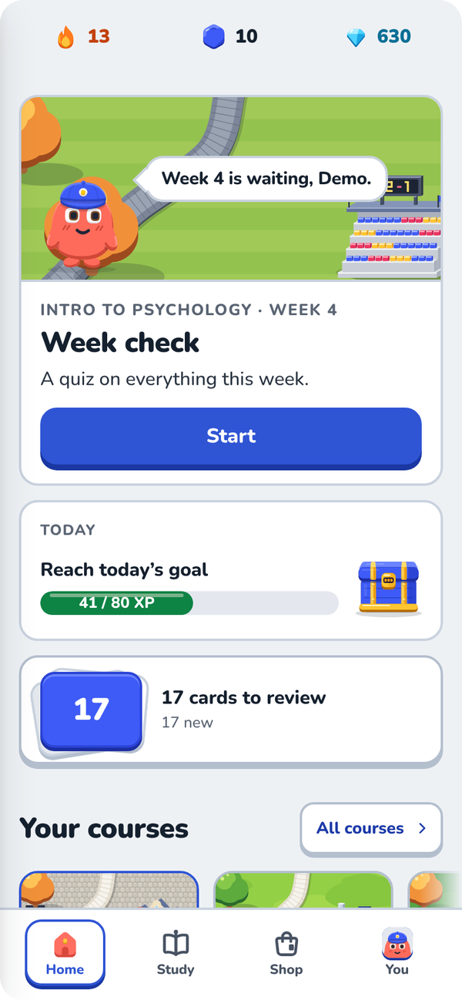</picture></td>
    <td width="33%"><picture><source media="(prefers-color-scheme: dark)" srcset="docs/study-dark.png">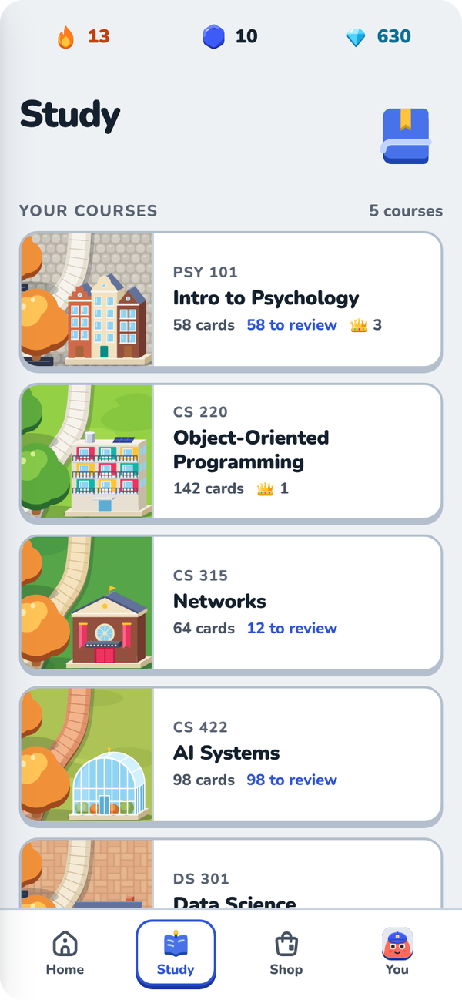</picture></td>
    <td width="33%"><picture><source media="(prefers-color-scheme: dark)" srcset="docs/you-dark.png">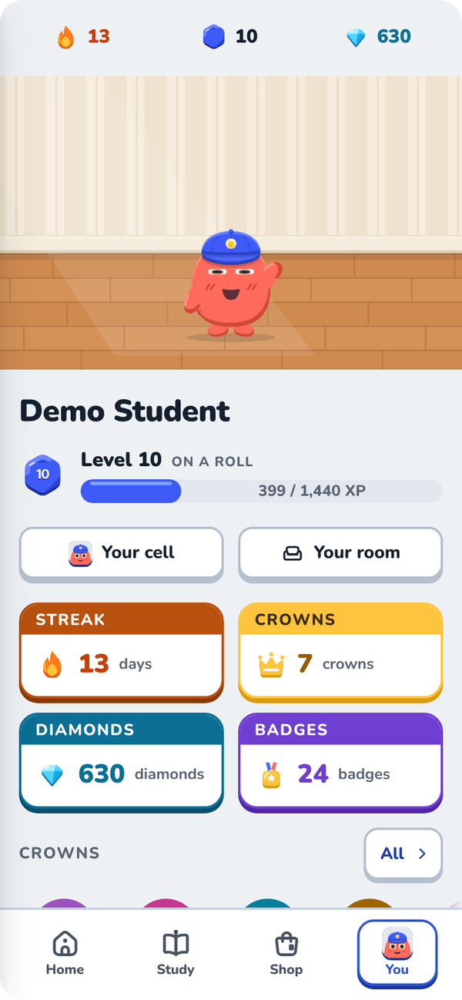</picture></td>
  </tr>
  <tr>
    <td align="center"><b>Home</b> The next step, today's goal, cards due</td>
    <td align="center"><b>Study</b> Every course, one path each</td>
    <td align="center"><b>You</b> Your cell, your room, your counts</td>
  </tr>
</table>

Four tabs: Home, Study, Shop and You. Home says what is next and opens it in one tap. The top bar
holds three things, each a number in its own colour: the streak, the level and the diamonds. The
streak's flame stays grey until today counts; there is no countdown and no red, and no bell.

## The week's path

<table>
  <tr>
    <td width="42%"><picture><source media="(prefers-color-scheme: dark)" srcset="docs/path-dark.webp">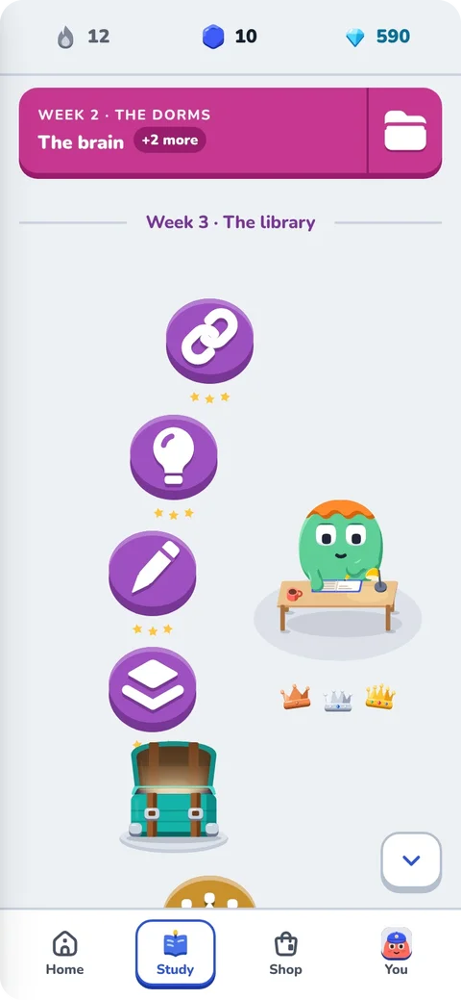</picture></td>
    <td valign="top">
      Every week of a course is one smooth bend of round keys: no labels, no line between them. A
      practised step takes the week's own colour and its stars; the next step is cobalt, in a ring;
      the rest wait in grey, never locked.  
      One banner stays on top and names the week in view, in the colour of the place on the campus
      that week is (the library, the sports field, the canal). After the steps come the week's chest
      and the Week check, and beside the bend stands the week's one scene, a classmate at a desk or
      shooting hoops, with the week's three crowns under it.  
      A tap on a key opens a popover in the week's colour: what the step asks and Start. The scenes
      move on smooth loops and stand still in Calm mode.
    </td>
  </tr>
</table>

## Practice

<table>
  <tr>
    <td width="25%"><picture><source media="(prefers-color-scheme: dark)" srcset="docs/cards-dark.webp">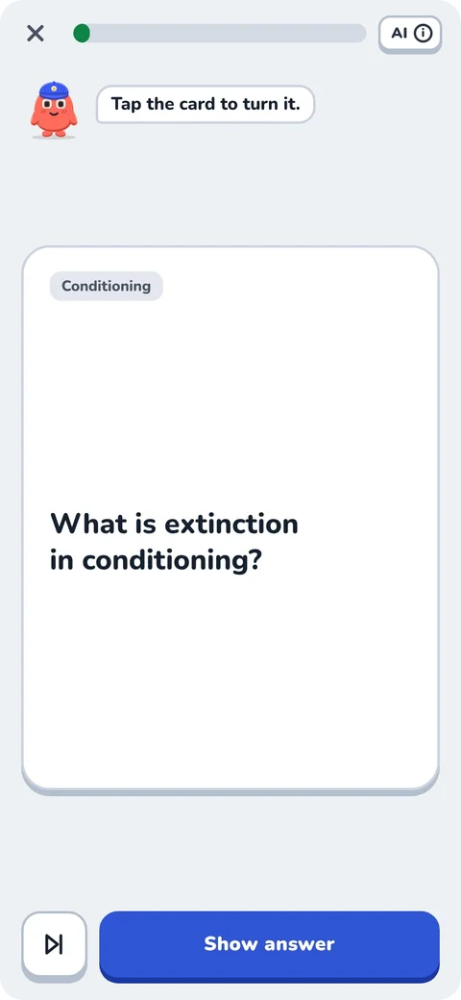</picture></td>
    <td width="25%"><picture><source media="(prefers-color-scheme: dark)" srcset="docs/match-dark.webp">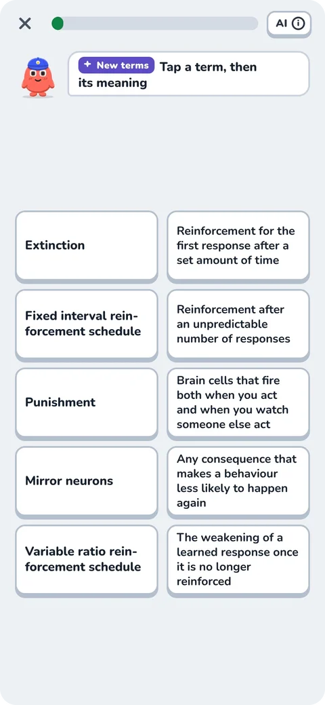</picture></td>
    <td width="25%"><picture><source media="(prefers-color-scheme: dark)" srcset="docs/step-dark.webp"></picture></td>
    <td width="25%"><picture><source media="(prefers-color-scheme: dark)" srcset="docs/typed-dark.webp">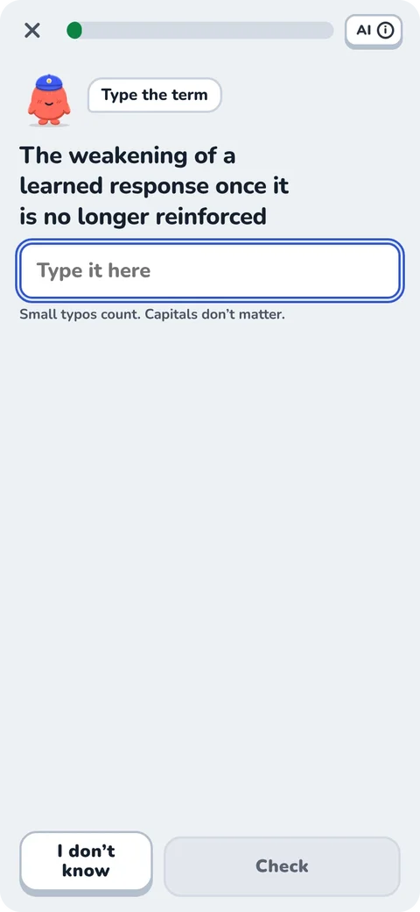</picture></td>
  </tr>
  <tr>
    <td align="center"><b>Cards</b> Got it, or again later</td>
    <td align="center"><b>Match</b> A term, then its meaning</td>
    <td align="center"><b>Pick</b> "Not yet", never a buzzer</td>
    <td align="center"><b>Type</b> From memory</td>
  </tr>
</table>

Every game fits one phone screen: the bar with its **AI ⓘ** chip, your cell with a bubble that says
what the item asks, the item, and one row of keys. An answer is one beat: the verdict wipes up over
that row with its sound (and, on a phone, a short vibration). A miss is "Not yet." in a warm colour,
with the right answer shown, and the item comes back once at the end of the session. Five right in a
row is called, and the bar burns orange.

## The Week check

<table>
  <tr>
    <td width="33%"><picture><source media="(prefers-color-scheme: dark)" srcset="docs/week-check-dark.png">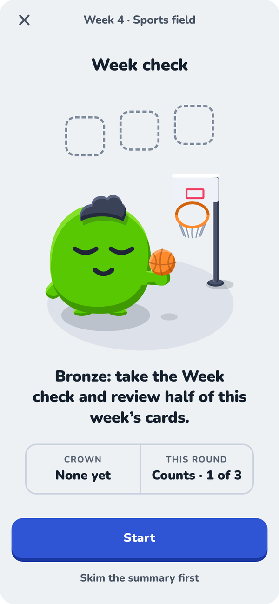</picture></td>
    <td width="33%"><picture><source media="(prefers-color-scheme: dark)" srcset="docs/quiz-dark.webp">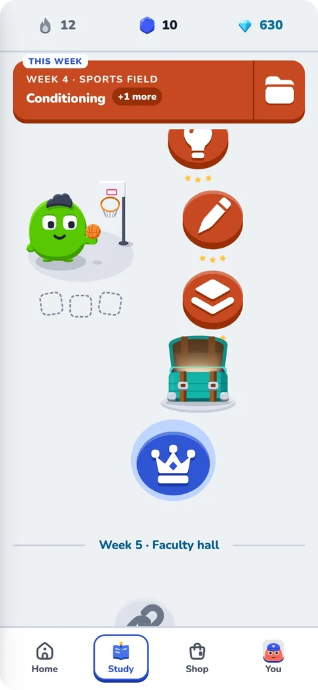</picture></td>
    <td valign="top">
      After a week's steps comes its <b>Week check</b>: the week's quiz, untimed and free. It counts
      toward the week's crowns (bronze, silver, gold, and they add up); a round that doesn't count
      is a practice round, and it says so.  
      Each answer gets its verdict at once, and <b>Why? ›</b> opens the explanation.
    </td>
  </tr>
</table>

## The end of a session

<table>
  <tr>
    <td width="33%"><picture><source media="(prefers-color-scheme: dark)" srcset="docs/end-dark.webp">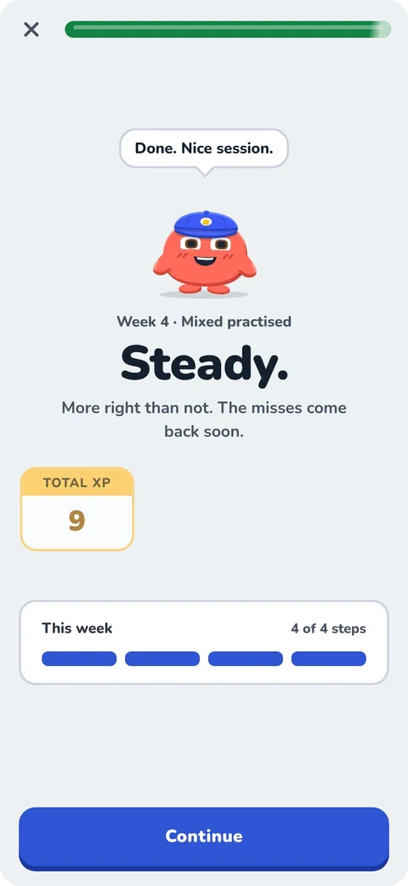</picture></td>
    <td width="33%">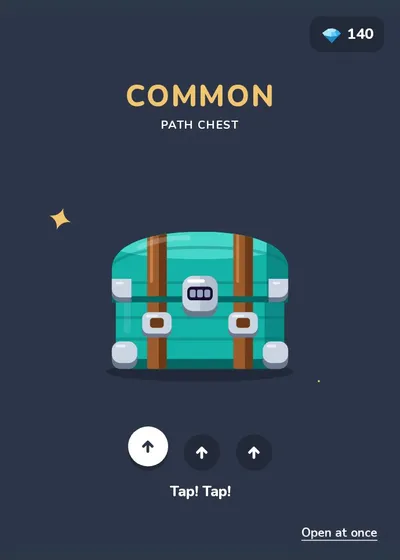</td>
    <td valign="top">
      With rewards on, the end of a session counts what it brought, one page per thing, each in
      its own colour: the XP, the streak (on the day's first study), the daily goal, a chest.  
      The week's path chest pops up as soon as its last step is practised. What it holds was fixed
      when it was earned: the taps only show it.
    </td>
  </tr>
</table>

## Unlock, never buy

<table>
  <tr>
    <td width="33%"><picture><source media="(prefers-color-scheme: dark)" srcset="docs/shop-dark.png">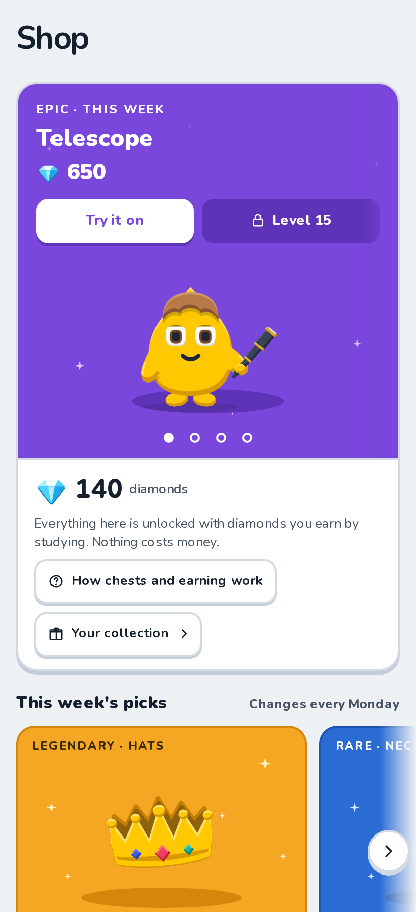</picture></td>
    <td width="33%">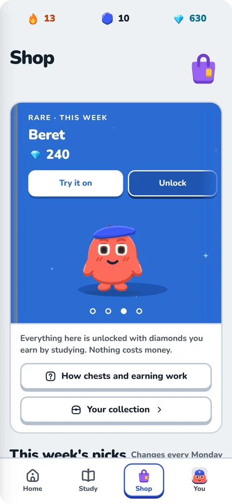</td>
    <td width="33%"><picture><source media="(prefers-color-scheme: dark)" srcset="docs/collection-dark.png">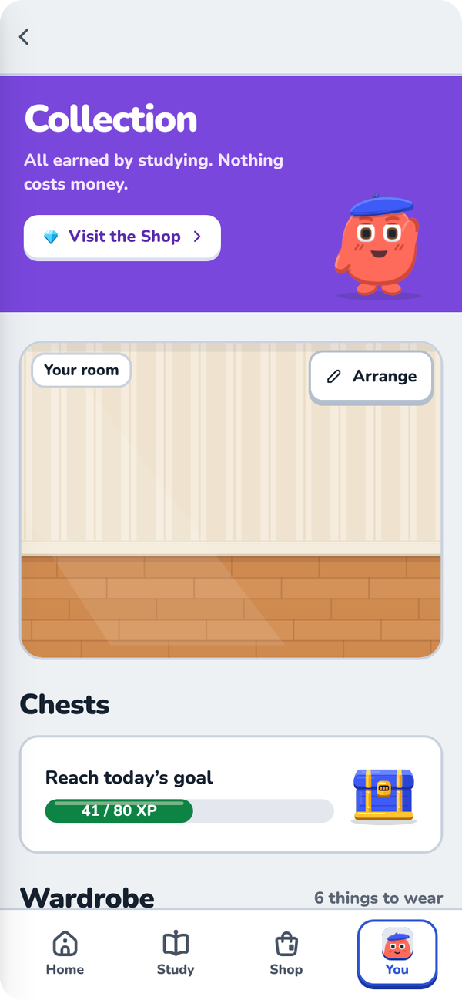</picture></td>
  </tr>
  <tr>
    <td align="center"><b>The Shop</b> Unlock, never buy</td>
    <td align="center"><b>An unlock</b> The sheet, then the item rises</td>
    <td align="center"><b>The Collection</b> Only what you own</td>
  </tr>
</table>

**Earned by studying, never bought.** Studying pays XP and diamonds; diamonds unlock things for your
cell and its room. Nothing in StudySync can be bought with money. What a chest holds is fixed when you
earn it, and the odds of a chance item are in the Shop. A school decides whether rewards are on at
all.

## Badges, the course summary and settings

<table>
  <tr>
    <td width="33%"><picture><source media="(prefers-color-scheme: dark)" srcset="docs/badges-dark.png">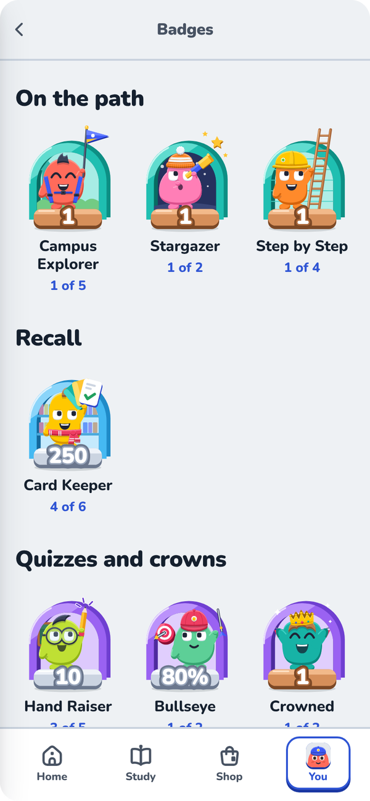</picture></td>
    <td width="33%"><picture><source media="(prefers-color-scheme: dark)" srcset="docs/summary-dark.png">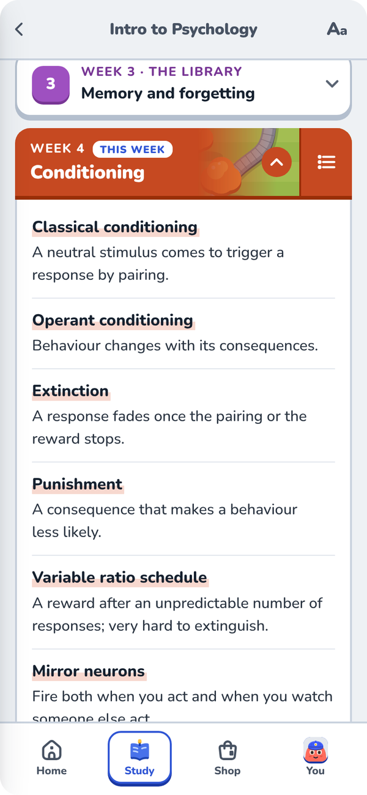</picture></td>
    <td width="33%"><picture><source media="(prefers-color-scheme: dark)" srcset="docs/settings-dark.png">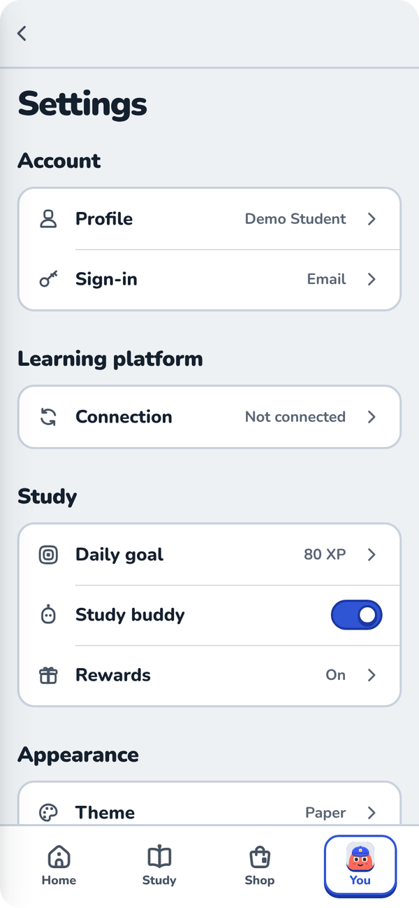</picture></td>
  </tr>
  <tr>
    <td align="center"><b>Badges</b> Awards with levels</td>
    <td align="center"><b>Course summary</b> One topic per week</td>
    <td align="center"><b>Settings</b> Grouped, one tap each</td>
  </tr>
</table>

Badges are awards with levels, each drawn as a classmate doing the thing. The course summary reads as
a guidebook: each topic sits under its week's banner, the week it was opened from is open, and every
topic ends with a key to practise that week.

## Live, for the whole class

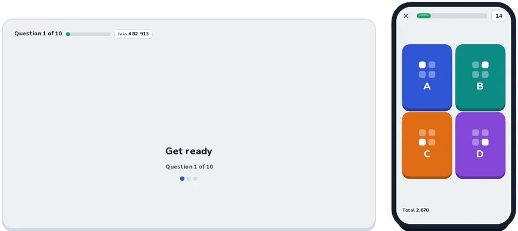

**Live** is a quiz for the whole class, on Canvas courses a teacher teaches. The teacher opens it on a
week, or several, the class joins on their phones with a code, and the quiz runs itself to the podium.
The question stays on the class screen; a phone shows only the answer keys and its own result. By
default every player gets a made-up name and a cell grown from it, so the board says nothing about who
is who.

## On a phone

There is an **Android app**: a thin native shell around the web app, so every update to the site is in
the app at once. What it adds is native: strong haptics on answers and moments, **Sign in with Moodle**
with one tap on the school's own Moodle page instead of copying a key, files opened in the phone's own
viewer, and the back button. It is a test build for now, not in the Play Store. An **iOS** app is in
progress.

The screens above are the screens the app shows.

## For schools

- **Students' own access.** Each student's material comes in through that student's own access to
  the learning platform.
- **Staff see little.** Staff accounts a school sets up see a roster with last activity and
  programme totals. Nobody on staff sees a student's answers, scores or rewards.
- **Tokens stay on the server.** Learning-platform tokens are encrypted (AES-256-GCM) and never
  reach the browser; files are downloaded through the server.
- **AI is labelled.** Every card and question is marked as AI-made, with its sources and a way to
  report it.
- **Calm mode.** One switch, or the device's reduced-motion setting, and nothing moves on its own.
- **Data location.** The database is in the EU.

Moodle and Canvas work today. Support for **Blackboard Learn** is in preparation: built, switched off,
and not live at any school. Brightspace and other platforms are not supported.

## The website

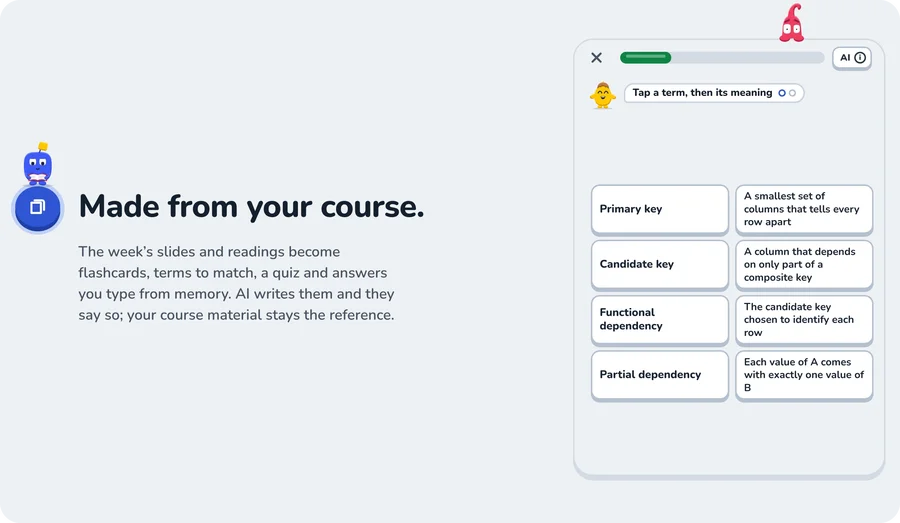

[studysync.nl](https://studysync.nl) shows the app in demos built from the app's own code: a practice
session, a week of the path, the chest, and Live on [its own page](https://studysync.nl/platform/live).

## Built with

| Part | What |
| --- | --- |
| Frontend | Next.js 16, TypeScript (strict), CSS variables, Zustand, Framer Motion |
| Backend | Node.js, Express, PostgreSQL, a Postgres-backed job queue |
| Android | A Capacitor shell with its own native plugin (haptics, Moodle sign-in, files) |
| AI | Anthropic Claude for cards, quizzes, summaries; Google Gemini as a fallback, unless a school's deployment is pinned to Anthropic |
| Checks | Type checks and tests on every pull request; tests that fail when a rule is broken, such as an untrue claim on the website or an answer key sent too early |

The drawings (the campus and its scenes, the cells, the chests, the icons) are the app's own SVG,
drawn and animated in code, with no stock illustrations. The sounds are synthesised in the browser.

## How it is built

By one person directing AI coding agents, mostly [Claude Code](https://claude.com/claude-code). The
direction, the rules the agents work under, and the checking are mine. The skills that came out of
that work are public: see [my profile](https://github.com/DevCrazyCube).

## Not in this repository

- The source code.
- Numbers about users. There are none to show before launch.
- A price. Pricing is discussed with schools.

## Contact

[studysync.nl](https://studysync.nl) · [@studysyncnl on Instagram](https://www.instagram.com/studysyncnl) · [Joyren Terken on LinkedIn](https://www.linkedin.com/in/joyren-terken-0bb02429a)

Recorded 2026-11-16 from the app as it is on studysync.nl. The app's pages are its own production
build running on example data (a made-up psychology course and an example student, no real people);
Live and the website are the demos on studysync.nl, which run the app's own components. © 2026 Joyren
Terken. The pictures, recordings and text here are not open source; ask before reusing them.
