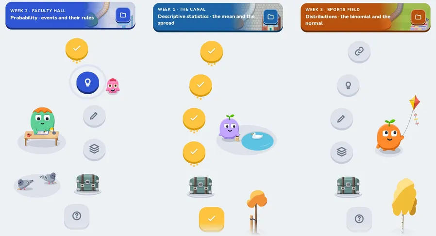
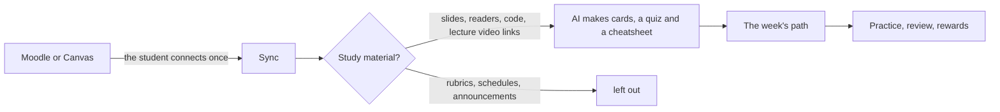
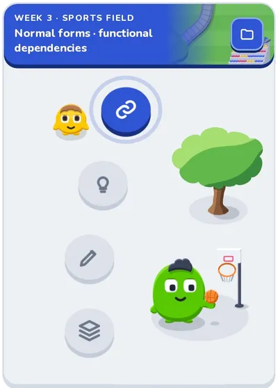
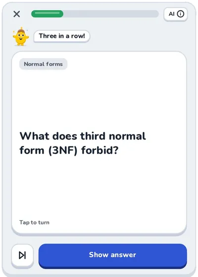
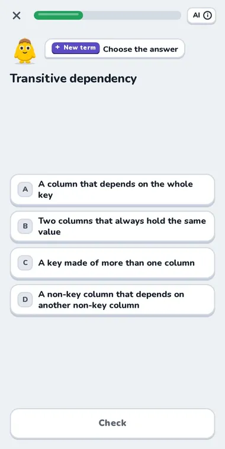
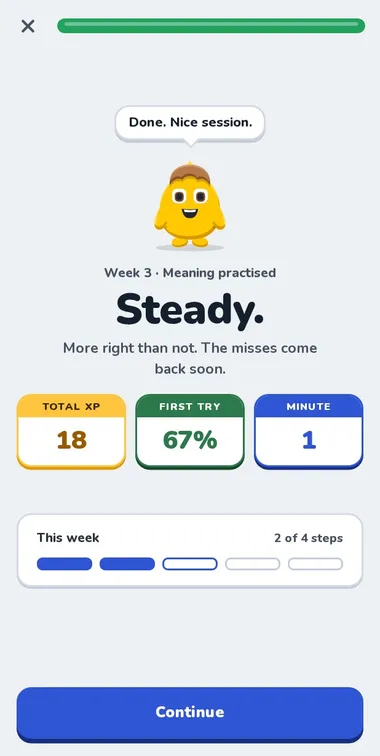
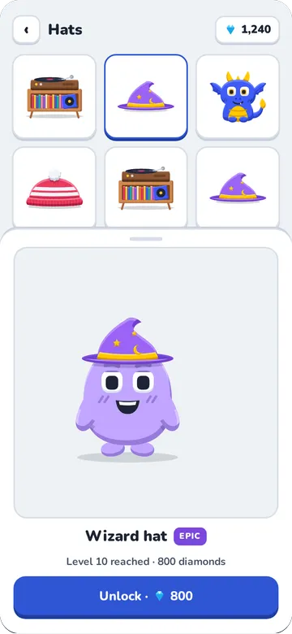
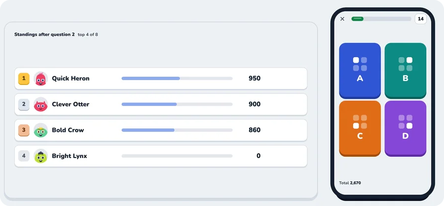

# StudySync

**Your course in Moodle or Canvas, turned into practice. Week by week.**

[studysync.nl](https://studysync.nl) · [@studysyncnl](https://www.instagram.com/studysyncnl)

<picture>
  <source media="(prefers-color-scheme: dark)" srcset="docs/path-scenes-dark.webp">
  
</picture>

## What this repository is

An explainer. It holds this page and the recordings on it, and no source code: the app's code is in a
private repository. Every recording here is the app's own code running on made-up example data: an
example databases or statistics course, an example student, invented player names. There are no real
students, courses or schools in them.

StudySync is pre-launch. It has no customers and no pilots yet, and runs as a private beta behind
invite codes.

## What it does

A student connects their school's learning platform once. StudySync reads the course, keeps what is
study material, and makes practice from it for every week of the course:

| | |
| --- | --- |
| **Flashcards** | From every part of the week's material, with spaced repetition: a card you miss comes back tomorrow, a card you know comes back after 1, 3, 7, 14 and then 30 days |
| **A path per course** | Each week is a short row of steps (match the words, pick the meaning, type it, all of it mixed), then the week's chest and a Week check |
| **A quiz per week** | Ten multiple-choice questions over the week's material |
| **A cheatsheet per course** | The course on one page |

The practice is made by AI and marked as AI-made: every session's bar has an **AI ⓘ** chip that says
where the item comes from, with the lecture's material and a way to report it. The course material
stays the reference.

## How it works

1. **Connect.** Moodle with a personal key (in the Android app: one tap on the school's own Moodle
   sign-in page); Canvas through the school's own sign-in.
2. **Sync.** Courses, weeks, files and deadlines come in. Rubrics, schedules, attendance lists and
   other course admin are left out, and a section with nothing to learn gets no deck.
3. **Generate.** All of the material is used, in chunks when it is long. Nothing is sampled away.
4. **Practise.** The week's steps, then the Week check. Cards you practised come back when they are due.

## The week's path

<table>
  <tr>
    <td width="42%"></td>
    <td valign="top">
      Every week of a course is one smooth bend of round keys: no labels, no dotted line. The next
      step is the lit one, and your own cell waits beside it.  
      A practised step turns gold and gets its stars, and the cell hops on to the next. After the
      last step the week's chest opens and the Week check lights up.  
      Each week is a place on a campus, and the open side of the bend holds that place's scene:
      classmates at a desk or flying a kite, ducks on a pond, pigeons, trees in the course's season
      (the picture at the top). It all moves on smooth, eased loops, and stands still in Calm mode.
    </td>
  </tr>
</table>

## A study session

<table>
  <tr>
    <td width="33%"></td>
    <td width="33%"><picture><source media="(prefers-color-scheme: dark)" srcset="docs/step-dark.webp"></picture></td>
    <td width="33%"><picture><source media="(prefers-color-scheme: dark)" srcset="docs/step-end-dark.webp"></picture></td>
  </tr>
  <tr>
    <td align="center"><b>Cards</b> Show answer, then Again or Got it</td>
    <td align="center"><b>A step</b> "Not yet", never a red buzzer</td>
    <td align="center"><b>The end</b> What the session brought</td>
  </tr>
</table>

Every game fits one phone screen: the bar with its **AI ⓘ** chip, your cell with a bubble that says
what the item asks, the item, and one row of keys. An answer is one beat: the verdict wipes up over
that row with its sound (and, on a phone, a short vibration), and the cell reacts a moment later. A
miss is "Not yet." in a warm colour, with the right answer shown, and the item comes back later in the
step. In the Week check, a verdict has **Why? ›**, which opens the explanation in a sheet.

With rewards on, the end of a session counts what it brought, one page per thing, each in its own
colour: the XP, the streak, the daily goal, a chest.

## Chests, unlocks and the Shop

<table>
  <tr>
    <td width="33%"></td>
    <td width="33%"></td>
    <td width="33%"><picture><source media="(prefers-color-scheme: dark)" srcset="docs/shop-dark.png"></picture></td>
  </tr>
  <tr>
    <td align="center"><b>The chest</b> Tap, tap, open</td>
    <td align="center"><b>An unlock</b> The item rises, alone</td>
    <td align="center"><b>The Shop</b> Unlock, never buy</td>
  </tr>
</table>

**Earned by studying, never bought.** Studying pays XP and diamonds; diamonds unlock things for your
cell and its room. Nothing in StudySync can be bought with money. What a chest holds is fixed when you
earn it: the taps only show it, and the odds of a chance item are in the Shop. A school decides
whether rewards are on at all.

## Live, for the whole class

**Live** is a quiz for the whole class, on Canvas courses a teacher teaches. The teacher opens it on a
week, or several, the class joins on their phones with a code, and the quiz runs itself to the podium.
The question stays on the class screen; a phone shows only the answer keys and its own result. By
default every player gets a made-up name and a cell grown from it, so the board says nothing about who
is who.

## On a phone

There is an **Android app**: a thin native shell around the web app, so every update to the site is in
the app at once. What it adds is native: strong haptics on answers and moments, **Sign in with Moodle**
with one tap on the school's own Moodle page instead of copying a key, files opened in the phone's own
viewer, and the back button. It is a test build for now, not in the Play Store. An **iOS** app is in
progress.

The screens in the recordings above are the screens the app shows.

## For schools

- **Students' own access.** Each student's material comes in through that student's own access to
  the learning platform.
- **Staff see little.** Staff accounts a school sets up see a roster with last activity and
  programme totals. Nobody on staff sees a student's answers, scores or rewards.
- **Tokens stay on the server.** Learning-platform tokens are encrypted (AES-256-GCM) and never
  reach the browser; files are downloaded through the server.
- **AI is labelled.** Every card and question is marked as AI-made, with its sources and a way to
  report it.
- **Calm mode.** One switch, or the device's reduced-motion setting, and nothing moves on its own.
- **Data location.** The database is in the EU.

Moodle and Canvas work today. Support for **Blackboard Learn** is in preparation: built, switched off,
and not live at any school. Brightspace and other platforms are not supported.

## Built with

| Part | What |
| --- | --- |
| Frontend | Next.js 16, TypeScript (strict), CSS variables, Zustand, Framer Motion |
| Backend | Node.js, Express, PostgreSQL, a Postgres-backed job queue |
| Android | A Capacitor shell with its own native plugin (haptics, Moodle sign-in, files) |
| AI | Anthropic Claude for cards, quizzes, cheatsheets and summaries; Google Gemini as a fallback, unless a school's deployment is pinned to Anthropic |
| Checks | Type checks and tests on every push; tests that fail when a rule is broken, such as an untrue claim on the website or an answer key sent too early |

The drawings (the campus and its scenes, the cells, the chests, the icons) are the app's own SVG,
drawn and animated in code, with no stock illustrations. The sounds are synthesised in the browser.

## How it is built

By one person directing AI coding agents, mostly [Claude Code](https://claude.com/claude-code). The
direction, the rules the agents work under, and the checking are mine. The skills that came out of
that work are public: see [my profile](https://github.com/DevCrazyCube).

## Not in this repository

- The source code.
- Numbers about users. There are none to show before launch.
- A price. Pricing is discussed with schools.

## Contact

[studysync.nl](https://studysync.nl) · [@studysyncnl on Instagram](https://www.instagram.com/studysyncnl) · [Joyren Terken on LinkedIn](https://www.linkedin.com/in/joyren-terken-0bb02429a)

Recorded 2026-11-15. The flashcards, the week on the path, the chest and Live are the demos on
studysync.nl, which run the app's own components; the path's scenes, the practice step, its end and
the Shop are the app's own pages on example data; the unlock is its approved prototype, which the
app's version follows. © 2026 Joyren Terken. The recordings and text here are not open source; ask
before reusing them.
